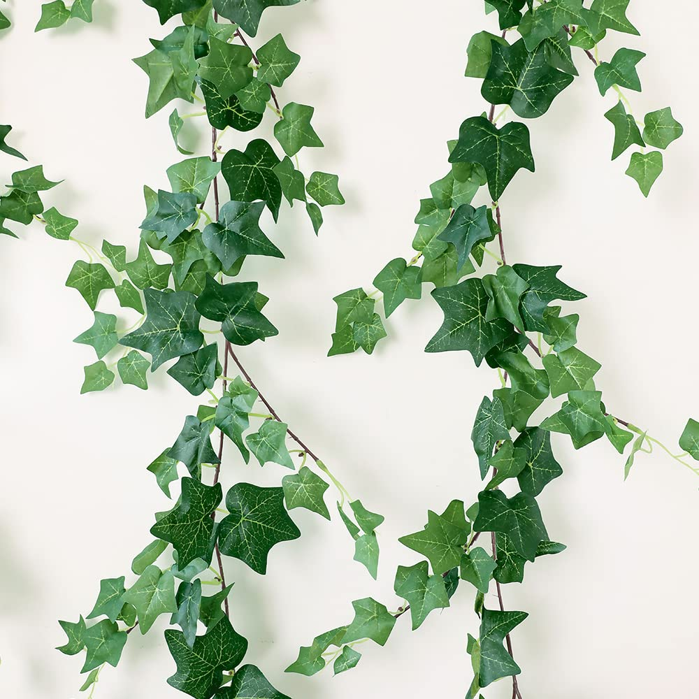

# Ivy leaf visual standard

**Status:** Current standard (2026-10-25). Supersedes the rounded "cottagecore" direction in
`COTTAGECORE_LEAF_PASS.md` for leaf *shape* and *colour*.

**Reference image:** `assets/reference/leaf-standard/ivy_leaf_standard.jpg` — English ivy garland
against a pale wall. Judge every leaf change against it.



---

## What the reference shows

| Trait | Standard | Current gap it targets |
|-------|----------|------------------------|
| **Silhouette** | Pointed 3–5 lobe palmate blade, distinct apical lobe, clear sinuses. Reads near-symmetric about the midrib. | Rounded clover blobs (rejected); scan damage (holes, bites) |
| **Midrib** | One crisp pale midrib from petiole to apex; palmate main veins radiate from the petiole. | Mirror-*averaging* ghosted a double midrib |
| **Colour** | Deep green blade (dark forest → mid green), **pale yellow-green veins with strong contrast**. Young leaves lighter/limier. | Washed grey-green scan, softened veins, warm "sage" grade |
| **Form** | Blade creased along the midrib (two halves catch light differently); slight droop of lobes. | Flat card or rectangular cup crease |
| **Surface** | Satin, not matte chalk and not wax. Soft sheen on the lit half. | Roughness floor 0.44 + flattened normals |
| **Petiole** | Visible thin pale-green stalk between stem and blade; blade held off the stem. | Blade glued directly to the node |
| **Health** | Clean leaves. No holes, bites, or brown spots. | b / e / f scan variants carry damage |

---

## Pipeline to meet it

1. **Atlas silhouette** — `tools/symmetrize_leaf_atlas.tscn` reads the original scans
   (`LeafSet017_Leaves_RGBA_scan.png`, `…NormalGL_scan.jpg`, `…Roughness_scan.jpg`). Per leaf it finds
   the midrib line (apex → petiole, or apex → brightest straight vein for heart-shaped bases), chooses
   a half (not clipped by the rect, then undamaged, then larger), and **reflects** it row by row about
   the midrib, re-centred so the petiole lands on `petiole_uv = (0.5, 1.0)`. Normal-map X is negated on
   the mirrored side. Then `Godot --headless --path <repo> --import` (the VRAM texture is otherwise stale).
2. **Grade** — `leaf.gdshader`: darken + saturate the blade, isolate pale veins by luminance and push
   them toward a yellow-green vein colour, plus a thin painted midrib at u = 0.5. Tier tints stay
   multiplicative.
3. **Form** — `LeafCupMesh`: SD-LEAF-1 cup plus a full-length midrib crease; no apical taper.
   `LeafRenderer` scales the instance z axis by blade width (it was unit length, which made the
   10° cup ~9 cm deep on a 5–7 cm leaf).
4. **Petiole** — the leaf mesh carries a thin stalk strip below the blade (UV v ∈ [1.5, 2.5]); the
   shader paints it petiole green. Render-only: the blade sits `PETIOLE_LEN` × height off the node.

**Simulation stays fixed:** `leaf_atlas.json` pins `reference_alpha_fill_a` (scan-measured 0.641).
Crowding deposit (`leaf_placer.gd`) and both coverage metrics read `LeafAtlas.reference_alpha_fill()`,
so atlas art passes cannot change growth or the AS-1 gates. Per-leaf `alpha_fill` is the measured
render value.

## QA

```bash
Godot res://tools/capture_single_leaf_card.tscn -- --id=a
Godot res://tools/capture_single_leaf_card.tscn -- --id=a --view=oblique
Godot res://tools/capture_single_leaf_card.tscn -- --id=all
```

Mechanical: `test/test_leaf_atlas_mirror.gd` (atlas alpha mirror-symmetric per rect),
`test/test_leaf_card_atlas.gd` (`alpha_fill` matches PNG).

## Non-goals

- New leaf atlas sets or species.
- Simulation changes (placement, crowding, coverage gates are untouched; petiole is render-only).
